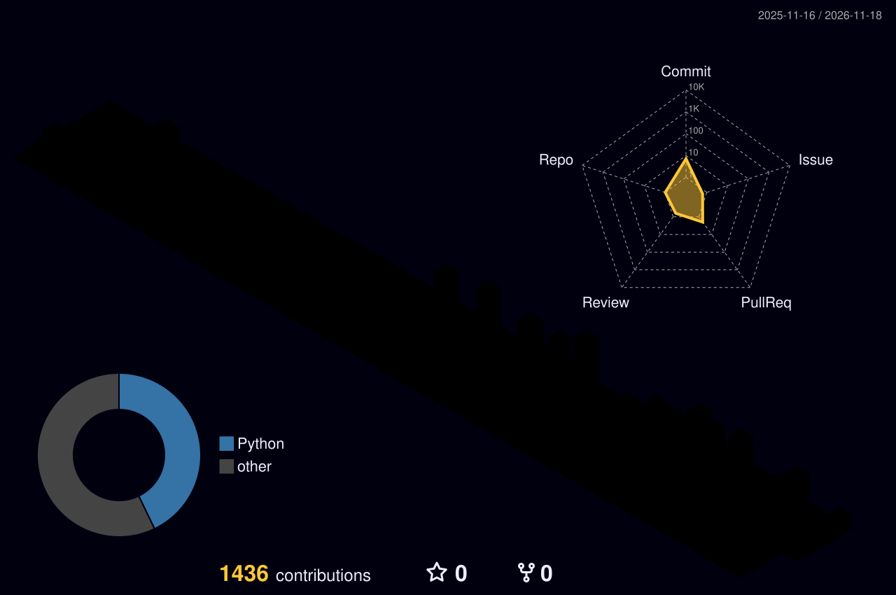

  

  
  

### About me

- I build **full-stack web and mobile products**, from the API and database to the UI.
- I work mostly in **TypeScript / Next.js**, **Python** and **Flutter / Dart**.
- I'm currently working on **ML model optimisation (quantisation)** and AI-powered platforms.
- I'm especially interested in software for **African markets**: logistics, student housing and education.

### Tech stack

  

### GitHub stats

  
  

### Contribution city

  

  <picture>
    <source media="(prefers-color-scheme: dark)" srcset="https://raw.githubusercontent.com/brendontinashe/brendontinashe/output/github-snake-dark.svg" />
    
  </picture>

