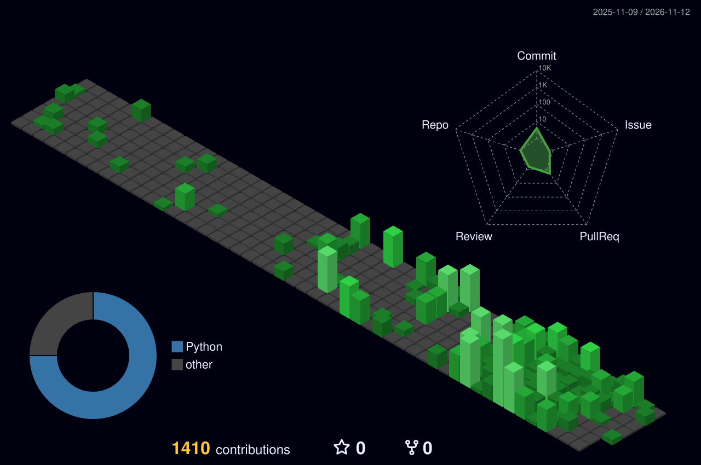

<h1 align="center">Brendon T Buwerimwe</h1>

  <b>Software Engineer</b> · Full-Stack Web & Mobile · Machine Learning

  
  

---

### About

I'm a software engineer who builds full-stack products end to end, from APIs and data models to web and mobile interfaces. I work mostly in **TypeScript / Next.js**, **Python** and **Flutter**. My current focus is **ML model optimisation (quantisation)** and AI-driven platforms.

I'm particularly interested in technology for **African markets**, including logistics, student housing and education.

### Tech stack

| Area | Tools |
|---|---|
| **Languages** | TypeScript · JavaScript · Python · Dart |
| **Frontend** | React · Next.js · Tailwind CSS · Three.js |
| **Mobile** | Flutter |
| **Backend & data** | Node.js · PostgreSQL · MongoDB · Firebase · Supabase |
| **ML** | PyTorch · model quantisation |
| **Tooling** | Git · Docker · Vercel · GitHub Actions |

### Contribution activity

  

  

